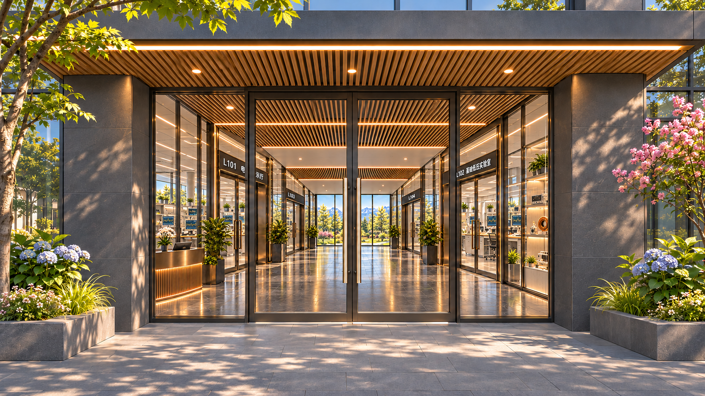
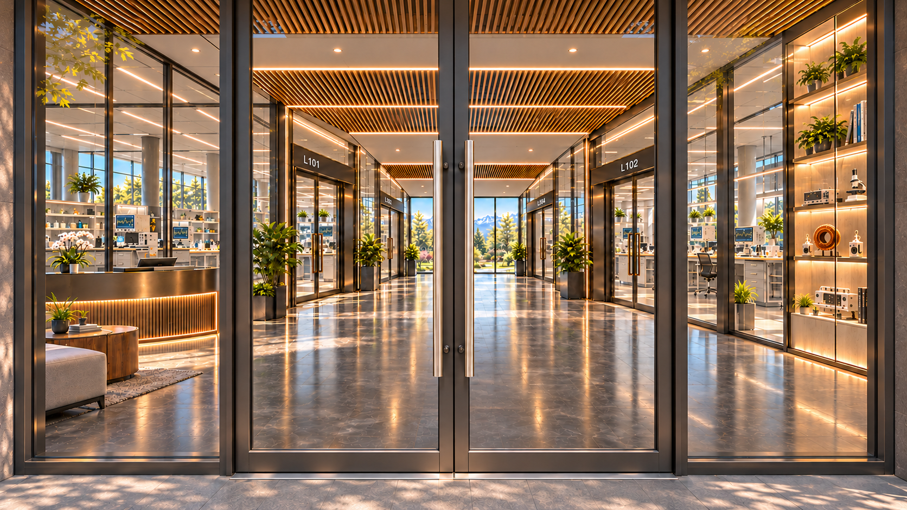
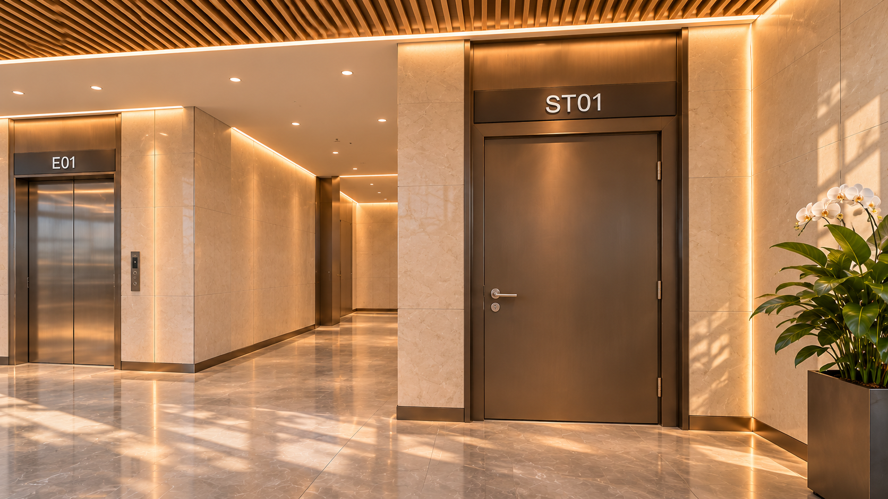
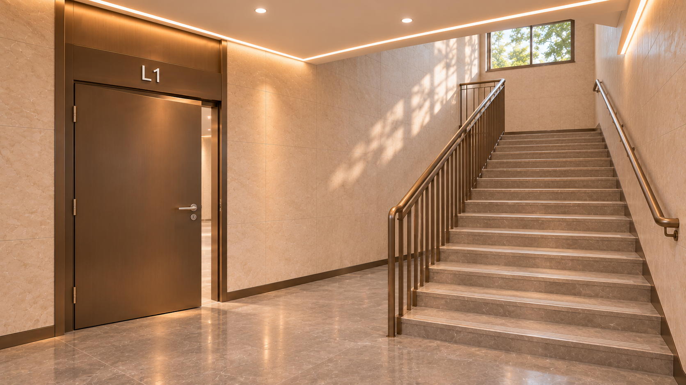

# 猫老师实验室 · CitadelLab

想做这样一个App：把广场、实验楼、工坊、学习和生活空间连起来，让人能进入不同场景，找到对象，学习、动手，再带着自己的进度回来。

这是一个需要逐步完成的大工程。把当前已经有的东西、还缺什么、接下来需要做什么放在这里。有兴趣的人可以先看看，也欢迎在Issue里讨论怎么一起做。

## 当前公开内容

- [阶段状态与验证边界](docs/STATUS-2026-11-08.md)
- [空间、对象与导航结构](docs/ARCHITECTURE.md)
- [下一步与协作方向](docs/ROADMAP.md)
- [关键源码参考](reference-source/README.md)：来自当前候选26，保留原逻辑。
- [四处入口画面](assets/README.md)：新增概念图，尚未接入App。
- [素材来源与许可说明](RIGHTS.md)

当前本地基线是候选26。本次公开的是说明、6份关键源码参考和4张新增画面，**不是完整可构建源码发行版，也没有发布可安装App**。完整工程还包括大量未在此轮公开的资产与依赖。

## 想表达的世界

“你得有这个资格才能干活，有这个能力才能干活，否则你就去学习。”

这是这个未来世界的一部分设想：金钱不再是组织生活的中心，学习、能力与做事相连，生活空间保持开放。它目前属于设计背景，具体资格与协作机制仍需设计，不能把这段设想当成已经实现的规则。

## 先看这条路线

广场 → 实验楼正门 → 大厅 → 前室 → ST01楼梯 → L2走廊 → L201实验室。

拖动画面用于观察。移动、进入、返回分别处理，不能拖一下视角就把人移进另一个房间。所有新画面与交互都要沿用已有节点、房间编号和路径关系。

### 正门入口

### 玻璃门槛

### ST01楼梯门

### 首层楼梯平台

以上4张是AI生成的有限透视场景，**不是360°全景素材，也不是App运行截图**。楼梯内部窗位和梯段方向仍需与原平面关系对齐。

## 参与方式

可以从具体问题开始：空间连续性、全景素材、触控体验、导航恢复、实验对象与状态管理。请先阅读[协作说明](CONTRIBUTING.md)，避免改坏现有结构或丢失资产。

项目尚未选择开源许可证。公开展示和讨论不代表已为全部代码、图片或第三方材料授予额外许可，详见[许可说明](RIGHTS.md)。
